# Lesss goo
- Week 1: JS, Callbacks, Async, Promises
- Week 1(Extra class Sunday): Backend Fundamentals, Express, Zod, Mongodb
  - Notes app backend, todo app backend
- Week 2: Started the Kalshi project
  - Basic on the first day.
  - Orderbook and all jargons on thursday
- Week 2(Extra Class, Friday): Completing the kalshi project
- Week 3 - Typescript 
- Week 3: class 2 - React started two classes

## 10th Nov
[Architecture diagram of the repo](https://gitdiagram.com/pritam-swe/100xdevs-wintercamp)

```mermaid

%% Generated by https://gitdiagram.com/pritam-swe/100xdevs-wintercamp
flowchart TD

subgraph group_learning["Language exercises"]
  node_async["Async exercises"]
end

subgraph group_backend["Backend demos"]
  node_fundamentals["Express fundamentals<br/>[index.js]"]
  node_notes["Notes backend<br/>[server.js]"]
end

subgraph group_todo["Todo API"]
  node_todo_entry["Todo server<br/>[index.js]"]
  node_todo_routes["Todo routes<br/>[todo.route.js]"]
  node_todo_validation["Request validation"]
  node_todo_schemas["Todo schemas<br/>[todo.schema.js]"]
  node_todo_handlers["Todo handlers"]
  node_todo_model["Todo model<br/>[todo.model.js]"]
  node_todo_db[("Mongo connection<br/>[db.js]")]
end

subgraph group_auth["Auth API"]
  node_auth_entry["Auth app<br/>[app.js]"]
  node_auth_routes["Auth routes<br/>[auth.route.js]"]
  node_course_routes["Course routes<br/>[course.route.js]"]
  node_profile_routes["Profile routes<br/>[profile.route.js]"]
  node_auth_validate["Schema validation<br/>[validate.schema.js]"]
  node_auth_guard["Protected route check"]
  node_auth_handlers["Signup and login<br/>[auth.js]"]
  node_user_shape["User input shapes<br/>[userShape.js]"]
  node_user_model[("User model<br/>[user.model.js]")]
end

subgraph group_frontend["React demos"]
  node_react_app["Course storefront app<br/>[App.tsx]"]
  node_course_selling["Course selling view<br/>[CourseSelling.tsx]"]
  node_react_basics["Course card app<br/>[App.tsx]"]
  node_course_card["Course card<br/>[CourseCard.tsx]"]
  node_api_tester["API tester demos<br/>[APITester.tsx]"]
end

subgraph group_kalshi["Kalshi project"]
  node_kalshi_entry["Kalshi project entry<br/>[index.js]"]
  node_kalshi_market["Market workflow<br/>[market.js]"]
  node_kalshi_resolve["Market resolution<br/>[resolve.js]"]
  node_kalshi_bet[("Bet records<br/>[bet.js]")]
  node_kalshi_market_model[("Market records<br/>[market.js]")]
  node_kalshi_wallet[("Wallet events<br/>[walletEvents.js]")]
end

node_learner(("Learner / API client"))

node_learner -.->|"runs examples"| node_async
node_learner -.->|"sends requests"| node_fundamentals
node_learner -.->|"sends requests"| node_notes
node_learner -.->|"sends requests"| node_todo_entry
node_learner -.->|"sends requests"| node_auth_entry
node_learner -.->|"views"| node_react_app
node_learner -.->|"views"| node_react_basics
node_learner -.->|"uses project"| node_kalshi_entry
node_todo_entry -->|"mounts"| node_todo_routes
node_todo_entry -->|"connects"| node_todo_db
node_todo_routes -->|"dispatches"| node_todo_handlers
node_todo_routes -->|"validates with"| node_todo_validation
node_todo_validation -.->|"uses schemas"| node_todo_schemas
node_todo_handlers -->|"reads and writes"| node_todo_model
node_auth_entry -->|"mounts"| node_auth_routes
node_auth_entry -->|"mounts"| node_course_routes
node_auth_entry -->|"mounts"| node_profile_routes
node_auth_routes -->|"validates with"| node_auth_validate
node_auth_routes -->|"uses shapes"| node_user_shape
node_auth_routes -->|"dispatches"| node_auth_handlers
node_auth_handlers -->|"imports validator"| node_auth_validate
node_auth_handlers -->|"reads and writes"| node_user_model
node_course_routes -->|"checks access"| node_auth_guard
node_course_routes -->|"queries user"| node_user_model
node_profile_routes -->|"checks access"| node_auth_guard
node_auth_guard -->|"loads user"| node_user_model
node_react_app -->|"renders"| node_course_selling
node_react_basics -->|"renders"| node_course_card
node_kalshi_entry -.->|"dispatches"| node_kalshi_market
node_kalshi_market -.->|"uses records"| node_kalshi_market_model
node_kalshi_market -.->|"uses bets"| node_kalshi_bet
node_kalshi_resolve -.->|"records events"| node_kalshi_wallet

click node_async "https://github.com/pritam-swe/100xdevs-wintercamp/tree/main/class-1-async-js"
click node_fundamentals "https://github.com/pritam-swe/100xdevs-wintercamp/blob/main/class-2-backend-fundamentals-22-oct/index.js"
click node_notes "https://github.com/pritam-swe/100xdevs-wintercamp/blob/main/notes-app-backend/server.js"
click node_todo_entry "https://github.com/pritam-swe/100xdevs-wintercamp/blob/main/todo-backend/src/index.js"
click node_todo_routes "https://github.com/pritam-swe/100xdevs-wintercamp/blob/main/todo-backend/src/routes/todo.route.js"
click node_todo_validation "https://github.com/pritam-swe/100xdevs-wintercamp/blob/main/todo-backend/src/middlewares/validation.middleware.js"
click node_todo_schemas "https://github.com/pritam-swe/100xdevs-wintercamp/blob/main/todo-backend/src/schemas/todo.schema.js"
click node_todo_handlers "https://github.com/pritam-swe/100xdevs-wintercamp/tree/main/todo-backend/src/controllers"
click node_todo_model "https://github.com/pritam-swe/100xdevs-wintercamp/blob/main/todo-backend/src/models/todo.model.js"
click node_todo_db "https://github.com/pritam-swe/100xdevs-wintercamp/blob/main/todo-backend/src/db.js"
click node_auth_entry "https://github.com/pritam-swe/100xdevs-wintercamp/blob/main/class-2.5-auth-25th-oct-extra/src/app.js"
click node_auth_routes "https://github.com/pritam-swe/100xdevs-wintercamp/blob/main/class-2.5-auth-25th-oct-extra/src/routes/auth.route.js"
click node_course_routes "https://github.com/pritam-swe/100xdevs-wintercamp/blob/main/class-2.5-auth-25th-oct-extra/src/routes/course.route.js"
click node_profile_routes "https://github.com/pritam-swe/100xdevs-wintercamp/blob/main/class-2.5-auth-25th-oct-extra/src/routes/profile.route.js"
click node_auth_validate "https://github.com/pritam-swe/100xdevs-wintercamp/blob/main/class-2.5-auth-25th-oct-extra/src/middlewares/validate.schema.js"
click node_auth_guard "https://github.com/pritam-swe/100xdevs-wintercamp/blob/main/class-2.5-auth-25th-oct-extra/src/middlewares/protectedRoute.check.js"
click node_auth_handlers "https://github.com/pritam-swe/100xdevs-wintercamp/blob/main/class-2.5-auth-25th-oct-extra/src/controllers/auth.js"
click node_user_shape "https://github.com/pritam-swe/100xdevs-wintercamp/blob/main/class-2.5-auth-25th-oct-extra/src/types/userShape.js"
click node_user_model "https://github.com/pritam-swe/100xdevs-wintercamp/blob/main/class-2.5-auth-25th-oct-extra/src/models/user.model.js"
click node_react_app "https://github.com/pritam-swe/100xdevs-wintercamp/blob/main/week-3-class-1-react-3rd-nov/class-2/src/App.tsx"
click node_course_selling "https://github.com/pritam-swe/100xdevs-wintercamp/blob/main/week-3-class-1-react-3rd-nov/class-2/src/components/CourseSelling.tsx"
click node_react_basics "https://github.com/pritam-swe/100xdevs-wintercamp/blob/main/week-3-class-1-react-3rd-nov/react-basics/src/App.tsx"
click node_course_card "https://github.com/pritam-swe/100xdevs-wintercamp/blob/main/week-3-class-1-react-3rd-nov/react-basics/src/CourseCard.tsx"
click node_api_tester "https://github.com/pritam-swe/100xdevs-wintercamp/blob/main/week-3-class-1-react-3rd-nov/class-2/src/APITester.tsx"
click node_kalshi_entry "https://github.com/pritam-swe/100xdevs-wintercamp/blob/main/class-4-27th-Oct/mini-kalshi/src/index.js"
click node_kalshi_market "https://github.com/pritam-swe/100xdevs-wintercamp/blob/main/class-4-27th-Oct/mini-kalshi/src/controller/market.js"
click node_kalshi_resolve "https://github.com/pritam-swe/100xdevs-wintercamp/blob/main/class-4-27th-Oct/mini-kalshi/src/controller/resolve.js"
click node_kalshi_bet "https://github.com/pritam-swe/100xdevs-wintercamp/blob/main/class-4-27th-Oct/mini-kalshi/src/model/bet.js"
click node_kalshi_market_model "https://github.com/pritam-swe/100xdevs-wintercamp/blob/main/class-4-27th-Oct/mini-kalshi/src/model/market.js"
click node_kalshi_wallet "https://github.com/pritam-swe/100xdevs-wintercamp/blob/main/class-4-27th-Oct/mini-kalshi/src/model/walletEvents.js"

classDef toneNeutral fill:#f8fafc,stroke:#334155,stroke-width:1.5px,color:#0f172a
classDef toneBlue fill:#dbeafe,stroke:#2563eb,stroke-width:1.5px,color:#172554
classDef toneAmber fill:#fef3c7,stroke:#d97706,stroke-width:1.5px,color:#78350f
classDef toneMint fill:#dcfce7,stroke:#16a34a,stroke-width:1.5px,color:#14532d
classDef toneRose fill:#ffe4e6,stroke:#e11d48,stroke-width:1.5px,color:#881337
classDef toneIndigo fill:#e0e7ff,stroke:#4f46e5,stroke-width:1.5px,color:#312e81
classDef toneTeal fill:#ccfbf1,stroke:#0f766e,stroke-width:1.5px,color:#134e4a
class node_async,node_learner toneBlue
class node_fundamentals,node_notes toneAmber
class node_todo_entry,node_todo_routes,node_todo_validation,node_todo_schemas,node_todo_handlers,node_todo_model,node_todo_db toneMint
class node_auth_entry,node_auth_routes,node_course_routes,node_profile_routes,node_auth_validate,node_auth_guard,node_auth_handlers,node_user_shape,node_user_model toneRose
class node_react_app,node_course_selling,node_react_basics,node_course_card,node_api_tester toneIndigo
class node_kalshi_entry,node_kalshi_market,node_kalshi_resolve,node_kalshi_bet,node_kalshi_market_model,node_kalshi_wallet toneTeal

```

